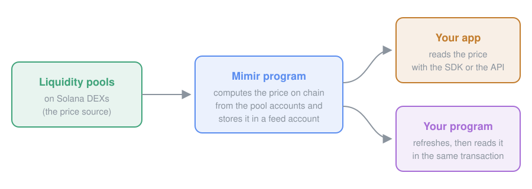

# Mimir SDK

TypeScript SDK for [Mimir](https://mimirfeeds.io/docs/), a Solana oracle that computes token and index prices on chain from liquidity pools.

## How it works



- Each **feed** stores its latest price in a feed account on Solana. Any RPC can read it and check it.
- A **refresh** instruction recomputes that price from the pools. Anyone can send it.
- A program that needs a current price puts the refresh in its own transaction, just before the instruction that reads the feed.

<details>
<summary>Words used in this README</summary>

| Word | Meaning |
|---|---|
| feed, classic feed, token feed | One token's price, from its liquidity pools (`kind: "token"`). |
| index | A weighted basket of token feeds (`kind: "index"`). |
| ticker | The feed's short name, such as `SOL` or `WIF`. |
| feed address | The base58 address of the feed account. |
| COLA | The token burned to claim a ticker when a feed is created. The SDK buys it for you with SOL. |

</details>

## Install

```bash
npm install @quantulabs/mimir-sdk
```

Node.js 20.18 or later, or any browser bundler (the root entry uses no Node built-in). The examples are ESM.

## What do you want to do?

| I want to… | Wallet | Through | Go to |
|---|:-:|---|---|
| Read a price | no | your RPC, or the free Mimir API | [Read a price](#read-a-price) |
| Follow prices live | no | your RPC, or the free Mimir API | [Follow prices live](#follow-prices-live) |
| Use a price in my Solana program | fee payer | your RPC | [Use a price in a program](#use-a-price-in-a-program) |
| Create a feed for a token | yes | your RPC | [Create a feed](#create-a-feed) |
| Create an index | yes | your RPC | [Create an index](#create-an-index) |

## Read a price

Read the feed accounts through your own RPC, or let the free Mimir API read them for you.

### Through your RPC

```ts
import { Mimir } from "@quantulabs/mimir-sdk";
const mimir = new Mimir({ rpc: process.env.SOLANA_RPC_URL });
const sol = await mimir.price("SOL");
console.log(sol.price, sol.slot, sol.confidenceBps); // e.g. 96.75 463266644n 1
```

`rpc` is the full HTTPS URL of a Solana RPC endpoint, API key included when your provider gives one:

| Provider | `rpc` |
|---|---|
| Solana public | `https://api.mainnet-beta.solana.com` |
| Helius | `https://mainnet.helius-rpc.com/?api-key=YOUR_KEY` |
| Alchemy | `https://solana-mainnet.g.alchemy.com/v2/YOUR_KEY` |
| QuickNode | `https://YOUR-ENDPOINT.solana-mainnet.quiknode.pro/YOUR_TOKEN/` |

With `rpc`, the SDK reads the chain and sends transactions through that RPC only, never through Mimir's servers. Without it, reads go to the Mimir API and transactions to Solana's public RPC, which is rate-limited and answers 403 to web pages. Other `new Mimir()` options: [docs/ADVANCED.md](./docs/ADVANCED.md#new-mimir-options).

### Through the free Mimir API

```ts
import { Mimir } from "@quantulabs/mimir-sdk";
const mimir = new Mimir();
const sol = await mimir.price("SOL");
console.log(sol.price, sol.slot, sol.confidenceBps); // e.g. 96.75 463266644n 1
```

No key, and it works from a browser.

### What you get

`price(tickerOrAddress)` takes a ticker (case-insensitive) or a feed address; `prices(list)` returns several, in input order.

| Field | Meaning |
|---|---|
| `ticker`, `kind`, `address` | The feed's ticker, `"token"` or `"index"`, and its account address (what a program reads) |
| `price` | The price **in USDC**, also for a feed whose pools are quoted in SOL. `null` when the feed cannot be priced, with `reason`. |
| `quote` | The quote token of the feed's pools (`quote?.symbol` is `"USDC"` or `"SOL"`) |
| `confidenceBps`, `dispersionBps` | Confidence, and spread between sources, in basis points |
| `slot`, `updatedAt` | The Solana slot whose pool states produced the price (anyone can replay it), and its Unix time |
| `token`, `sources`, `score`, `components` | API only: the token's `{ mint, symbol, name }`, the pools read, their score out of 100, and an index's components with weights |

Exact on-chain fields (`priceX64`, `status`, `generation`): `getPrice` in [`/advanced`](./docs/ADVANCED.md).

## Follow prices live

`watch` calls you back with each price, every 5 seconds by default (`{ intervalMs }`, minimum 2,000). It returns `stop()`.

```ts
import { Mimir } from "@quantulabs/mimir-sdk";
const mimir = new Mimir({ rpc: process.env.SOLANA_RPC_URL });
const stop = mimir.watch(["SOL", "TSLAX"], (p) => console.log(p.ticker, p.price, p.quote?.symbol), (e) => console.error(e.code));
setTimeout(stop, 60_000);
```

Errors go to the third argument; one with `retry: "never"` stops the watch. The list is read as one batch, so an unknown ticker stops it too.

## Use a price in a program

Put a Mimir refresh just before your own instruction, in the same transaction. Your program then reads a price computed in that transaction.

This path always reads the chain through an RPC: the [`rpc`](#through-your-rpc) you pass, or Solana's public RPC if you pass none. It never uses the Mimir API.

```ts
import { Mimir } from "@quantulabs/mimir-sdk";
import { Transaction } from "@solana/web3.js";
const mimir = new Mimir({ wallet, rpc: process.env.SOLANA_RPC_URL });
const tx = new Transaction().add(...await mimir.withFreshPrice("SOL", [yourInstruction]));
// sign and send tx: your program reads the SOL feed account after the refresh
```

- It returns a compute-budget instruction, the refreshes in the order you gave, then your instructions, nothing in between. Several feeds: `withFreshPrice(["SOL", "WIF"], [ix])`.
- The fee payer is the wallet, or `withFreshPrice(feeds, ixs, { payer })` without one. A token feed refresh carries no Mimir fee.

### Read the price onchain

Your program must check the feed's owner, its pin, the refresh just before it, freshness, and use the bound that protects it. The checks, the offsets and the cookbook program to start from: [docs/ONCHAIN.md](./docs/ONCHAIN.md).

## Create a feed

`createFeed` creates a classic feed for any token mint, with its first price, in two wallet approvals. Creation needs `rpc`: the SDK finds the pools and sends through it.

```ts
import { Mimir } from "@quantulabs/mimir-sdk";
import { readFileSync } from "node:fs";
const mimir = new Mimir({ wallet: JSON.parse(readFileSync("wallet.json", "utf8")), rpc: process.env.SOLANA_RPC_URL });
const feed = await mimir.createFeed({ mint: "EKpQGSJtjMFqKZ9KQanSqYXRcF8fBopzLHYxdM65zcjm" }); // WIF; 2 approvals
console.log(feed.ticker, feed.price.price, feed.feed);
```

By default the SDK finds the token's pools on your RPC and picks the set the Mimir App would, possibly several pools. `wallet` is any signer that can sign Transaction v1: a secret key or web3.js `Keypair`, a `@solana/kit` signer, or in a browser a Wallet Standard wallet (wallet-adapter: `useWallet().wallet`).

### Choose the pools yourself

Pass `pools` to price the token from those pools only. Every pool must hold the mint, and `quote` is their quote token.

```ts
import { Mimir } from "@quantulabs/mimir-sdk";
const mimir = new Mimir({ wallet, rpc: process.env.SOLANA_RPC_URL });
const feed = await mimir.createFeed({
  mint: "EKpQGSJtjMFqKZ9KQanSqYXRcF8fBopzLHYxdM65zcjm", // WIF
  pools: ["EP2ib6dYdEeqD8MfE2ezHCxX3kP3K2eLKkirfPm5eyMx"], // Raydium WIF/SOL
  quote: "SOL",
  ticker: "MYWIF",
});
```

A feed meant to be an index component must have exactly one pool.

### Check the cost first

`dryRun: true` returns the plan and the live cost. It needs no wallet and signs nothing. Fees are set on chain, so these docs quote no amount.

```ts
import { Mimir } from "@quantulabs/mimir-sdk";
const mimir = new Mimir({ rpc: process.env.SOLANA_RPC_URL });
const plan = await mimir.createFeed({ mint: "EKpQGSJtjMFqKZ9KQanSqYXRcF8fBopzLHYxdM65zcjm", dryRun: true });
console.log(plan.ticker, plan.steps.map((s) => s.kind), plan.tariffCola, plan.totalLamports);
```

Every option, the wallets you can pass, resuming an interrupted creation and the server + browser split: [docs/CREATE.md](./docs/CREATE.md).

## Create an index

`createIndex` creates a weighted basket of 2 to 5 feeds, with its first price.

**Index components.** Components are existing **classic feeds**: give their tickers, feed addresses or mints. For now each must be a **single-pool** classic feed. If one does not exist, create it first with `createFeed({ mint, pools: [onePool] })`.

```ts
import { Mimir } from "@quantulabs/mimir-sdk";
const mimir = new Mimir({ wallet, rpc: process.env.SOLANA_RPC_URL });
// 1. a missing component: a classic feed with one pool
const wif = await mimir.createFeed({ mint: "EKpQGSJtjMFqKZ9KQanSqYXRcF8fBopzLHYxdM65zcjm", pools: ["EP2ib6dYdEeqD8MfE2ezHCxX3kP3K2eLKkirfPm5eyMx"], quote: "SOL" });
// 2. the index, from its components and their quantities
const index = await mimir.createIndex({ ticker: "MYINDEX", components: { [wif.ticker]: 1, MRVL: 1, INTC: 1 } });
console.log(index.ticker, index.price.price);
```

The result has the same shape as `createFeed`'s. Options and how each component is resolved: [docs/CREATE.md](./docs/CREATE.md#index-components).

## Errors

Every error is a `MimirError` with `code`, `retry` and `hint`. `retry` is `"now"`, `"later"`, `"after-refresh"` or `"never"`. Every code and what to do: [docs/ERRORS.md](./docs/ERRORS.md).

## More

| | |
|---|---|
| Step-by-step guide | [docs/QUICKSTART.md](./docs/QUICKSTART.md) |
| Creating feeds and indexes in detail | [docs/CREATE.md](./docs/CREATE.md) |
| Using a price in a program | [docs/ONCHAIN.md](./docs/ONCHAIN.md) |
| Errors | [docs/ERRORS.md](./docs/ERRORS.md) |
| Lower-level entry points (`/advanced`, `/v1`, `/beta`) | [docs/ADVANCED.md](./docs/ADVANCED.md) |
| Program id (mainnet) | `hBYrGHXVCQsnduDERkVnViCXNYawpHCvN5y3GsMiMiR` |
| Docs, API, App | https://mimirfeeds.io/docs/ · https://api.mimirfeeds.io · https://app.mimirfeeds.io |
| Cookbook (consumer programs) | https://github.com/QuantuLabs/mimir-cookbook |
| License | Apache-2.0 |
