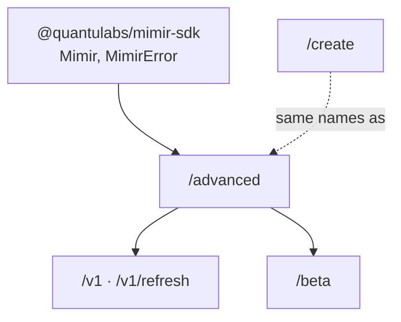

# Advanced entry points

The root entry, `@quantulabs/mimir-sdk`, exports the `Mimir` client and `MimirError`. Start there: it covers reading, refreshing and creating.

The sub-paths below expose the lower layers the root is built on.

These sub-paths can change from one release to the next; if you use them, pin the SDK version.

## `new Mimir()` options

| Option | Meaning |
|---|---|
| `wallet` | Signs the creation steps; omit it to read only. The kinds it accepts: [CREATE.md](./CREATE.md#which-wallet-can-i-pass). |
| `rpc` | Your RPC URL. Every read and transaction goes there, nothing to the Mimir API. Without it, reads use the Mimir API and transactions Solana's public RPC. Creation needs it. |
| `cluster` | `"mainnet"` (default) or `"devnet"`. Devnet needs `rpc`; Mimir has no published devnet deployment yet. |
| `api` | The Mimir API base URL, for self-hosting or tests. |

## Which entry point?

| Import from | What it is for | Use it instead of the root when… |
|---|---|---|
| `@quantulabs/mimir-sdk` | The `Mimir` client: read, watch, refresh, create | (the default) |
| `/advanced` | Function-style API with exact on-chain fields, step-level creation, V0 helpers | you need `status`, `priceX64`, `generation`, your own `Connection`, or code written for the earlier root API |
| `/v1` | V1 account layouts, decoders and instruction builders | you decode feed accounts or build Mimir instructions yourself |
| `/v1/refresh` | Single-feed refresh preparation through a web3.js `Connection` | you build a refresh with your own connection and no Mimir client |
| `/create` | The create functions, under their earlier import path | existing code imports them from there; new code uses the root or `/advanced` |
| `/beta` | The injected client the Mimir App uses for creation and ownership | you build a creation UI and control every deployment value |



## `/advanced`

```ts
import { getPrice } from "@quantulabs/mimir-sdk/advanced";
```

<details>
<summary>Everything it exports</summary>

| Group | Names |
|---|---|
| Read | `getPrice`, `getPrices`, `watchPrices`, `decodePrice`, `simulatePrice`, `listFeeds`, `getFeedInfo` |
| Refresh | `withFreshPrice`, `refreshInstructions`, `mergeFreshPrice`, `toWeb3Instruction` |
| Pools and scores | `scoreFeed`, `recommendPools`, `recommend`, `poolCandidates`, `dlmmRouteableDepth`, `venueLabel` |
| Create | `planFeed`, `createFeed(plan, opts)`, `planComposite`, `createComposite`, `prepareFeedStep`, `prepareCompositeStep`, `jupiterSwapBuild` |
| Tokens and tickers | `resolveToken`, `autoTicker`, `existingFeeds` |
| Wallets | `keyPairSigner`, `normaliseWallet` |
| Constants | `MIMIR_PROGRAM_IDS` |
| V0 helpers | Account codecs, instruction builders, PDAs, source graph, routeable depth, mint oracle and consumer helpers |

</details>

The V0 helpers expect a global `Buffer`: Node, or a polyfill in a browser.

Code written for the earlier root API keeps working with one change: import from `/advanced`.

```diff
- import { getPrice } from "@quantulabs/mimir-sdk";
+ import { getPrice } from "@quantulabs/mimir-sdk/advanced";
```

## `/v1`

The V1 account layouts and instruction builders.

| Export | What it does |
|---|---|
| `V1Layout` | Byte offsets of the feed and index accounts |
| `decodeV1ClassicFeed`, `decodeV1CompositeFeed`, … | Decode a token feed or an index account |
| `checkV1ConsumerPin` | Check a pinned program id, address and generation |
| `listV1ClassicFeeds`, `listV1Composites` | List feeds with `getProgramAccounts`, which many RPC providers restrict |
| `prepareMimirV1ClassicRefresh`, `prepareMimirV1CompositeRefresh` | Prepare one feed's refresh through a web3.js `Connection` (also in `/v1/refresh`) |

## `/beta`

Feed creation and ownership, as the [Mimir App](https://app.mimirfeeds.io) uses them. Browser-safe.

| Export | What it does |
|---|---|
| `createMimirBetaClient` | An injected client. You pass every deployment value (program ids, collection); there are no cluster defaults. |
| its methods (`listPoolSources`, `searchSpotPools`, `prepareSimpleFeed`, `prepareCompositeFeed`, `inspectFeedOwnership`, …) | Return the next unsigned transaction, with a review of what it writes |
| `compileMimirBetaTransactionV1` | Compile instructions to a Transaction v1 message |
| Instruction builders, account codecs, rent and error helpers | The parts the client uses |

`/beta` never sends a transaction and never picks an RPC endpoint: your code does both.

Creating a feed costs a ticker fee and account rent: see [Fees](https://mimirfeeds.io/docs/guides/fees.html).

## Deprecated exports

| In | Deprecated | Use instead |
|---|---|---|
| `/advanced` | `createMimirRefreshReadConsumerInstructions` | `withFreshPrice` |
| `/advanced` | `createMimirAuditedDirectReadConsumerInstructions` | `withFreshPrice` |
| `/advanced` | `createMimirCompositeRefreshReadConsumerInstructions` | `withFreshPrice` |
| `/create`, `/advanced` | `prepareFeed` | `planFeed` |
