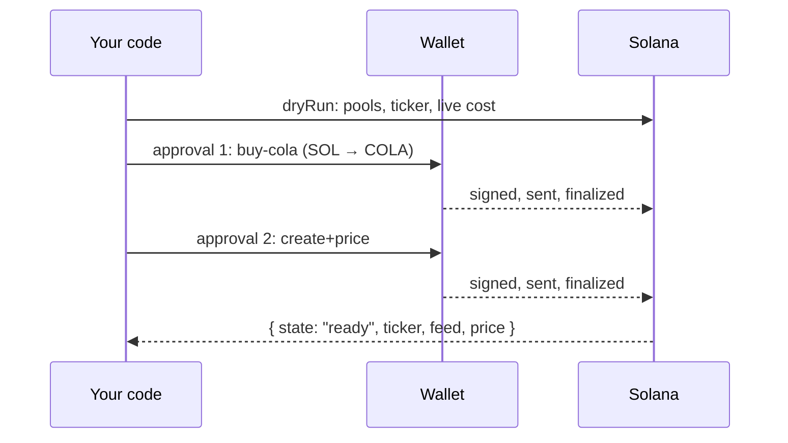

# Quickstart

From a first price to a price used on chain, one step at a time.

## Before you start

| You need | For |
|---|---|
| Node.js 20.18 or later | every step |
| A Solana RPC URL in `SOLANA_RPC_URL` | steps 5 and 6; optional, recommended, in step 2 ([what to put there](../README.md#through-your-rpc)) |
| A funded wallet | step 6 only |

In the examples, `RPC_URL` stands for your RPC URL, `FEED_ADDRESS` for a feed account address, `MINT` for a token mint, and `wallet` / `walletAddress` for your wallet and its base58 address.

Steps 2 and 6 use the root client, `Mimir`. Steps 3 to 5 use lower-level functions from `@quantulabs/mimir-sdk/advanced`, which return the exact on-chain fields. See [ADVANCED.md](./ADVANCED.md).

## 1. Install

```bash
npm install @quantulabs/mimir-sdk
```

The package works with `import` and `require`, and bundles for a browser.

## 2. Read a price

Read the feed account on chain through your RPC:

```ts
import { Mimir } from "@quantulabs/mimir-sdk";
const mimir = new Mimir({ rpc: process.env.SOLANA_RPC_URL });
const price = await mimir.price("COLA");
console.log(price.ticker, price.price, price.quote?.symbol, price.slot, price.reason);
```

Or, with no setup, ask the free Mimir API:

```ts
import { Mimir } from "@quantulabs/mimir-sdk";
const mimir = new Mimir();
const price = await mimir.price("COLA");
console.log(price.ticker, price.price, price.quote?.symbol, price.slot, price.reason);
```

Expected output, either way:

```text
COLA 0.00014310791290546743 SOL 463266182n undefined
```

| Part | Meaning |
|---|---|
| `0.000143…` | The price **in USDC**, even though the COLA pools are quoted in SOL |
| `SOL` | The quote of the feed's pools |
| `463266182n` | The slot whose pool states produced the price |
| `undefined` | `reason` is set only when `price` is `null` |

<details>
<summary>Where the price comes from</summary>

- With `new Mimir({ rpc })`: the feed accounts on your RPC only, no Mimir server involved.
- Without `rpc`: the free Mimir API. No key, works from a browser. HTTP 429 is retried twice after `Retry-After`, then `RATE_LIMITED`.
- `price` takes a ticker (case-insensitive) or a feed address. `prices(list)` reads several, in input order.

</details>

## 3. Read the exact on-chain price

`getPrice` returns the feed account's own fields: status, exact bounds, validity window.

```ts
import { getPrice } from "@quantulabs/mimir-sdk/advanced";
const p = await getPrice("COLA");
console.log(p.ticker, p.status, p.live, p.price, p.quote, p.slot, p.validUntilSlot);
```

Expected output:

```text
COLA fresh true 0.000001478350516213834 SOL 463266185n 463266335n
```

> [!IMPORTANT]
> `getPrice` returns the price **in the feed's quote**: here in SOL. Only `mimir.price` converts to USDC.

### `status`: can I use this price?

| `status` | Meaning | What to do |
|---|---|---|
| `"fresh"` | Valid at the slot of the read | Use it |
| `"needs-refresh"` | The last price, past `validUntilSlot` | Display it. To act on it on chain, refresh in the same transaction (step 5). |
| `"degraded"` | The last good price, carried forward by a refresh that could not compute a new one | Display it; do not act on it |
| `"none"` | No price; `price` is `null` | Nothing to show |

### `live`: stored or simulated?

| `live` | Meaning |
|---|---|
| `true` | The SDK simulated a refresh (signature verification off, nothing sent): what a refresh would record now, **not** on-chain state. By default it does this for any feed whose stored price is not fresh. |
| `false` | The stored feed account. Also what you get when a simulation cannot run. |

Pass `{ live: false }` to read only the stored account. On chain, put the refresh in your transaction.

<details>
<summary>All fields of the <code>getPrice</code> result</summary>

| Field | Meaning |
|---|---|
| `feed` | Feed account address |
| `ticker` | Ticker, e.g. `COLA` |
| `kind` | `"token"` or `"index"` |
| `quote` | `"USDC"`, `"SOL"`, or the quote mint address |
| `status` | `"fresh"`, `"needs-refresh"`, `"degraded"` or `"none"` |
| `mode` | `"standard"`: the feed's recipe. `"current-point"`: one pool's price at this slot, no history; cap what you risk on it. |
| `live` | `true`: simulated now. `false`: stored account. |
| `price` | `number` for display; `null` when `status` is `"none"` |
| `priceX64`, `lowerX64`, `upperX64` | Exact price and its bounds, Q64.64 (`bigint`) |
| `mantissa`, `exponent` | `mantissa × 10^exponent`, the program's fixed-exponent form; coarse for small prices |
| `confidenceBps`, `dispersionBps` | Confidence, and spread between sources, in basis points |
| `slot`, `validUntilSlot`, `ageSlots`, `unixTs` | When the price was recorded, until when it is valid, its age at the read |
| `components` | Indexes only: each component's feed, quantity, price and slot |

`payer` sets the simulation's fee payer. By default, `getPrices` uses the creator of the first feed that needs a simulation.

</details>

### Read with your own connection

`decodePrice` decodes an account you fetched yourself. It checks the owner, that the account is not executable, and that the address is the feed's PDA.

```ts
import { Connection, PublicKey } from "@solana/web3.js";
import { decodePrice } from "@quantulabs/mimir-sdk/advanced";

const connection = new Connection(RPC_URL, "confirmed");
const feed = new PublicKey(FEED_ADDRESS);
const { context, value } = await connection.getAccountInfoAndContext(feed);
if (!value) throw new Error("feed not found");
const p = await decodePrice(
  { address: feed.toBase58(), owner: value.owner.toBase58(), executable: value.executable, data: value.data },
  { slot: context.slot },
);
```

Pass `generation` in the second argument to pin a feed generation. `decodePrice` always returns `live: false`.

## 4. Preview a refresh

```ts
import { simulatePrice } from "@quantulabs/mimir-sdk/advanced";
const [p] = await simulatePrice("COLA");
console.log(p.ticker, p.status, p.live, p.price);
```

Expected output:

```text
COLA fresh true 0.000001478350516213834
```

The SDK simulates the refresh and returns what it would record now. Nothing is signed or sent.

## 5. Use a fresh price on chain

Put the Mimir refresh right before your instruction, in the same transaction. Your program then reads the feed account.

```text
 one transaction
 ┌────────────────────┬─────────────────────┬──────────────────────┐
 │ compute budget     │ Mimir refresh(es)   │ your instruction(s)  │
 │                    │ in the order given  │ read the feed        │
 └────────────────────┴─────────────────────┴──────────────────────┘
                         nothing in between ─┘
```

### With SDK instructions

```ts
import { withFreshPrice } from "@quantulabs/mimir-sdk/advanced";

const { instructions, computeUnitLimit } = await withFreshPrice({
  feeds: ["COLA"],
  instructions: [yourInstruction],
  payer: walletAddress, // base58
  rpc: RPC_URL,
});
```

| Result | Meaning |
|---|---|
| `instructions` | Compute budget, the refreshes in order, then yours. SDK shape: `{ programAddress, accounts: [{ address, isSigner, isWritable }], data }` |
| `computeUnitLimit` | The refreshes' units plus yours. Your own `SetComputeUnitLimit`, if any, is merged in. |

### With web3.js instructions

```ts
import { ComputeBudgetProgram } from "@solana/web3.js";
import { refreshInstructions, toWeb3Instruction } from "@quantulabs/mimir-sdk/advanced";

const refresh = await refreshInstructions(["COLA"], { payer: wallet.publicKey.toBase58(), rpc: RPC_URL });
const instructions = [
  ComputeBudgetProgram.setComputeUnitLimit({ units: refresh.computeUnitLimit + 200_000 }),
  ...refresh.instructions.map(toWeb3Instruction),
  yourInstruction,
];
```

> [!WARNING]
> - Refreshes alone above 1,400,000 compute units throw `INVALID_INPUT`: split the feeds over several transactions.
> - A feed with many pools can be too large for a legacy or v0 transaction. `compileMimirBetaTransactionV1` in `/beta` builds a Transaction v1 ([ADVANCED.md](./ADVANCED.md)).

### What your program checks

1. The feed account's owner is the Mimir program.
2. Through the Instructions sysvar, the Mimir refreshes sit just before it: with k feeds, at relative positions −k to −1, in the order given.
3. The price's status, then its own limits.

[ONCHAIN.md](./ONCHAIN.md) has the full checklist and offsets; the [cookbook](https://github.com/QuantuLabs/mimir-cookbook) has consumer programs.

A token feed refresh carries no Mimir fee. An index refresh that records a new price pays a refresh fee in SOL ([Fees](https://mimirfeeds.io/docs/guides/fees.html)).

## 6. Create a feed

Check the cost with a dry run, then create.

```ts
import { Mimir } from "@quantulabs/mimir-sdk";
const mimir = new Mimir({ wallet, rpc: process.env.SOLANA_RPC_URL });
const plan = await mimir.createFeed({ mint: MINT, dryRun: true });
console.log(plan.ticker, plan.steps.map((s) => s.kind), plan.totalLamports, plan.tariffCola, plan.warnings);
const feed = await mimir.createFeed({ mint: MINT });
```

Expected output of the dry run, here for WIF (`MINT = "EKpQGSJtjMFqKZ9KQanSqYXRcF8fBopzLHYxdM65zcjm"`). The amounts are read from the chain at the time of the call, so they are left out:

```text
WIF [ 'buy-cola', 'create+price' ] <lamports>n <COLA> [
  "EKpQGSJtjMFqKZ9KQanSqYXRcF8fBopzLHYxdM65zcjm: the symbol comes from the token's own metadata, not a verified list",
  "SOL-quoted pools scored best: the feed is SOL-quoted; prices are returned in USDC through Mimir's SOL/USDC feed",
  'totalLamports excludes the ticker tariff (tariffCola); the buy-cola review shows its SOL amount'
]
```

### What happens



- **Each step** is built just in time. The wallet sees its exact review: simulated debit, network fee, writes, compute, size.
- **The wallet must not change** anything but the network fee; otherwise `REVIEW_CHANGED`, and nothing is sent.
- **Pools:** pass `pools`, or the SDK finds them on your RPC, checks them on chain, and picks the set the Mimir App would.
- **Recipes:** chosen per pool (native-bounded, else current-point, else default); `recipe` overrides. Interval recipes throw `NOT_SUPPORTED` for now.
- **The COLA purchase** uses Jupiter's keyless `GET /swap/v2/build` (public, rate-limited). Every build is checked and simulated before you sign.

Options, wallets, resume and the server + browser split: [CREATE.md](./CREATE.md).

## Errors

Every error is a `MimirError` with `code`, `name`, `retry` and `hint`. `MimirError.from(error)` classifies any failed send or simulation.

| `retry` | What to do |
|---|---|
| `"now"` | Rebuild the transaction from fresh reads and resend |
| `"after-refresh"` | Put the Mimir refresh before your instruction in the same transaction |
| `"later"` | Unavailable right now; retry in a few seconds (`Retry-After` gives the wait) |
| `"never"` | Retrying will not help; check the feed, the program id and the accounts |

<details>
<summary>Codes raised by the <code>/advanced</code> functions</summary>

| Code | Meaning |
|---|---|
| `NOT_FOUND`, `TICKER_NOT_FOUND` | Unknown feed or ticker |
| `TICKER_MISMATCH` | The feed's ticker is not the one asked for |
| `NOT_A_FEED`, `WRONG_OWNER`, `EXECUTABLE`, `WRONG_ADDRESS`, `MALFORMED` | The account is not a valid Mimir feed |
| `GENERATION_MISMATCH` | The feed's generation is not the pinned one |
| `CLOSED_PROGRAM` | The account belongs to a closed Mimir program id |
| `INVALID_INPUT` | A bad argument, or refreshes above 1,400,000 compute units |
| `RPC` | The RPC failed |
| `EXPIRED` | The blockhash expired |
| `PLAN_STALE` | A pool moved while the refresh was prepared |
| `TICKER_TAKEN`, `UNPRICEABLE`, `INSUFFICIENT_SOL`, `SWAP_UNAVAILABLE`, `REVIEW_CHANGED`, `NOT_SUPPORTED` | Creation errors ([ERRORS.md](./ERRORS.md)) |
| `UNKNOWN` | Anything else |

Program errors keep their numeric code and name. Without program logs, `MimirError.from(error, { instructions })` attributes a custom error to Mimir only when Mimir is the instruction at the failing index.

</details>

## Program id

| Cluster | Program id |
|---|---|
| mainnet | `hBYrGHXVCQsnduDERkVnViCXNYawpHCvN5y3GsMiMiR` (`MIMIR_PROGRAM_IDS.mainnet`) |
